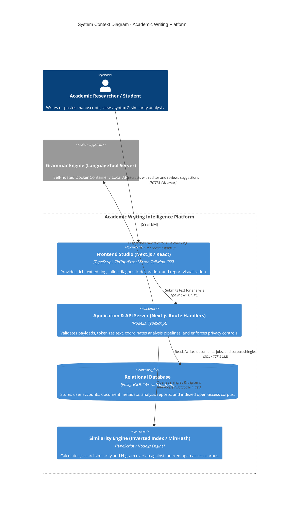
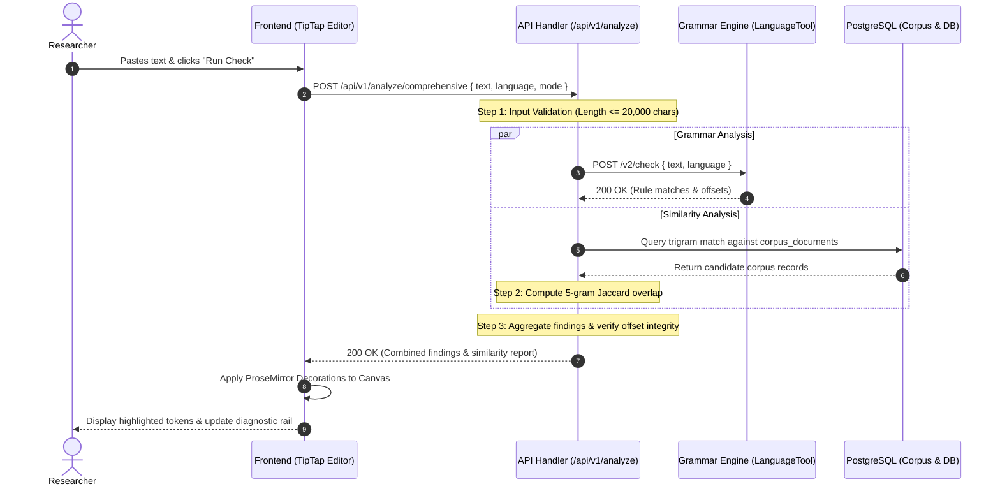
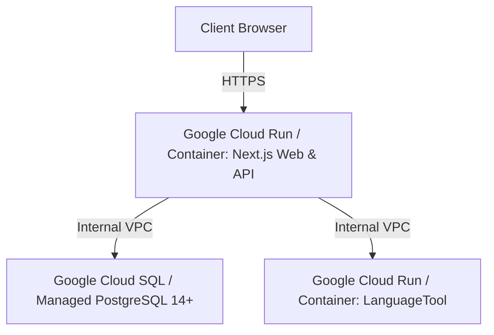

# SYSTEM ARCHITECTURE SPECIFICATION (`ARCHITECTURE.md`)
**Project:** Academic Writing Intelligence Platform (`academic-writing-platform`)  
**Version:** 1.0.0-MVP  
**Status:** Approved for Implementation  
**Role:** Principal Software Architect

---

## 1. System Context & Component Boundaries

The Academic Writing Intelligence Platform is designed as a modular, privacy-first system. It separates stateless analytical computation from user data persistence, ensuring that user documents can be examined either ephemerally (zero-retention) or stored within a private workspace.

---

## 2. Responsibilities by Component

### 2.1 Frontend Studio (`components/` & `app/`)
* **Rich Text Editing:** Powered by TipTap (ProseMirror engine). Provides immutable document AST, atomic replacement transactions, and character-offset mapped decorations.
* **Inline Diagnostic Rendering:** Renders grammar errors as red underlines and similarity matches as amber highlights.
* **Coordinate Anchoring:** Calculates DOM bounding rectangles to anchor suggestion popovers directly beneath the targeted token.
* **State Management:** Reactive client-side document state with optimistic UI updates and real-time word/character count calculations.

### 2.2 Backend & API Gateway (`app/api/v1/`)
* **Request Validation:** Validates character count (max 20,000 characters for MVP), language code (`id-ID`, `en-US`, `en-GB`), and payload schema.
* **Pipeline Orchestrator:** Triggers grammar and similarity engines concurrently via `Promise.allSettled()`, ensuring failure in one engine does not terminate the other.
* **Offset Harmonizer:** Normalizes character offsets across multi-line breaks (`\r\n` vs `\n`) and Unicode multi-byte graphemes.
* **Privacy Guardrail:** Strips raw document text from logs, emitting only execution metadata (word count, duration, error codes).

### 2.3 Grammar Engine Adapter (`lib/engines/grammar/`)
* Dispatches requests to the LanguageTool server.
* Maps LanguageTool rule categories into unified domain categories: `spelling`, `grammar`, `style`, `punctuation`.
* Translates LanguageTool byte/character offsets into absolute UTF-16 code unit offsets matching the browser's ProseMirror model.

### 2.4 Similarity Engine (`lib/engines/similarity/`)
* **Text Normalization:** Lowercasing, whitespace collapsing, punctuation stripping, and tokenization.
* **5-Gram Shingling:** Extracts overlapping 5-token sequences.
* **Corpus Matching:** Uses PostgreSQL `pg_trgm` and hash matching against `corpus_documents` to retrieve candidate matches, then evaluates exact sentence-level overlap.
* **Attribution Formatter:** Generates verifiable source cards containing author, year, title, and DOI URL.

### 2.5 Database (`PostgreSQL 14+`)
* Stores relational entities defined in `SCHEMA.md`.
* Operates trigram indexing (`gin_trgm_ops`) over corpus text for sub-second similarity candidate filtering.
* Enforces data isolation and foreign key cascading.

---

## 3. Data Flow & Request Lifecycles

### 3.1 End-to-End Analysis Request Flow

---

## 4. Failure Modes & Resilience Strategies

| Failure Scenario | Impact | System Resilience Strategy |
| :--- | :--- | :--- |
| **LanguageTool Service Offline** | Grammar checks fail | Returns partial result: Similarity report succeeds; Grammar tab displays `SERVICE_UNAVAILABLE` with clear retry option. App does not crash. |
| **PostgreSQL Unreachable** | Persistence & Similarity blocked | In-memory fallback for guest mode grammar checking. Similarity returns an informative message indicating local corpus database is offline. |
| **Pasted Text Exceeds Limit** | Potential engine memory exhaustion | Fast 400 Bad Request rejection at API gateway before tokenization or external calls occur. |
| **Invalid Unicode / Formatting** | Character offset misalignment | Text is sanitized and normalized at the boundary; UTF-16 code units are consistently enforced across client and server. |

---

## 5. Deployment Topology

### 5.1 Local Development Environment (Active Phase)
* **Web App:** Next.js development server running natively on Node.js 26.5.0 (`http://localhost:3000`).
* **Database:** PostgreSQL running natively (`psql 14.20`) or via Docker container (`port 5432`).
* **LanguageTool:** Docker container (`erikvl87/languagetool`) running locally on port 8010.
* **Network Boundary:** All traffic is confined to `localhost`. Zero external data transmission.

### 5.2 Future Production Topology (Subject to Owner Approval)

---

## 6. Operational Costs & Privacy Risks

### 6.1 Operational Cost Model Baseline
* **Local Development:** $0.00 / month.
* **Staging / Initial Production:** Low-cost container deployment (estimated < $20/month with scale-to-zero when idle). Zero third-party pay-per-token API consumption in P0 MVP.

### 6.2 Privacy & Intellectual Property Safeguards
1. **Zero Logging of Document Contents:** Console outputs, server access logs, and error aggregators strictly log:
   `[INFO] Job completed: id=3f1b... length=1420 words=210 duration_ms=412`
   Raw text content is NEVER passed to loggers.
2. **Ephemeral Guest Processing:** Unauthenticated sessions are processed in volatile memory and never persisted to disk unless the user explicitly requests saving.
3. **No External LLM Data Transmission in P0:** All P0 processing is executed on self-hosted local services.
